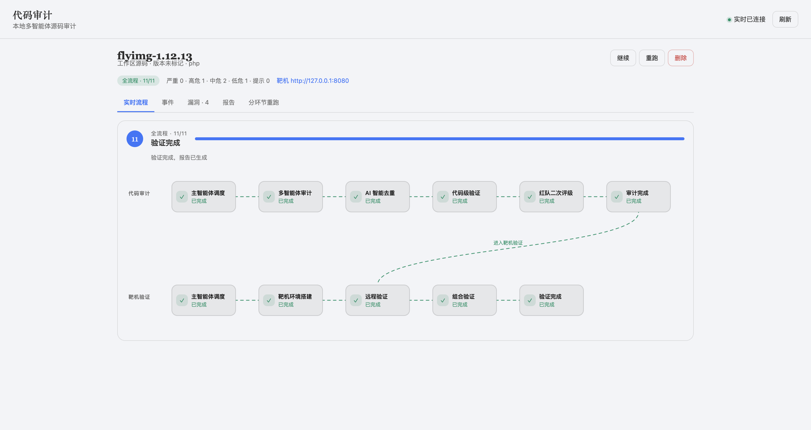
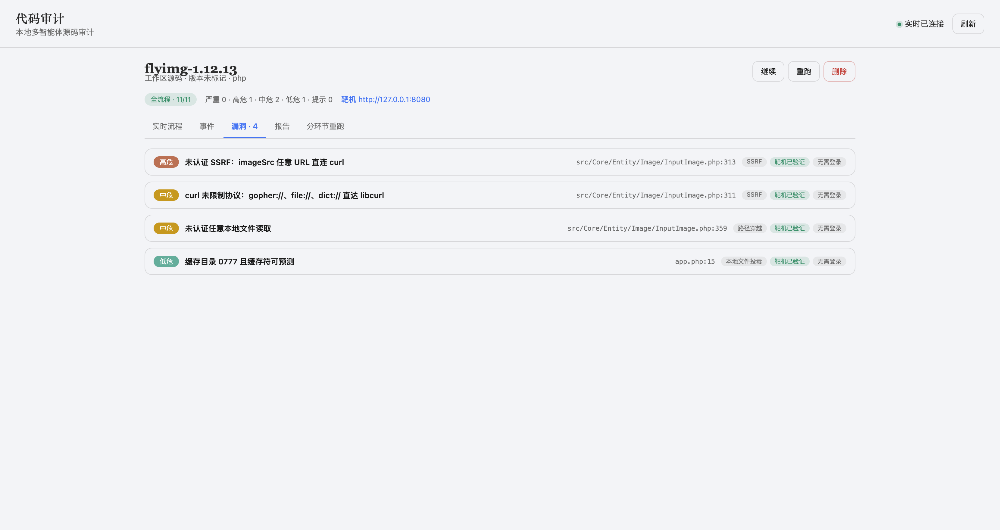
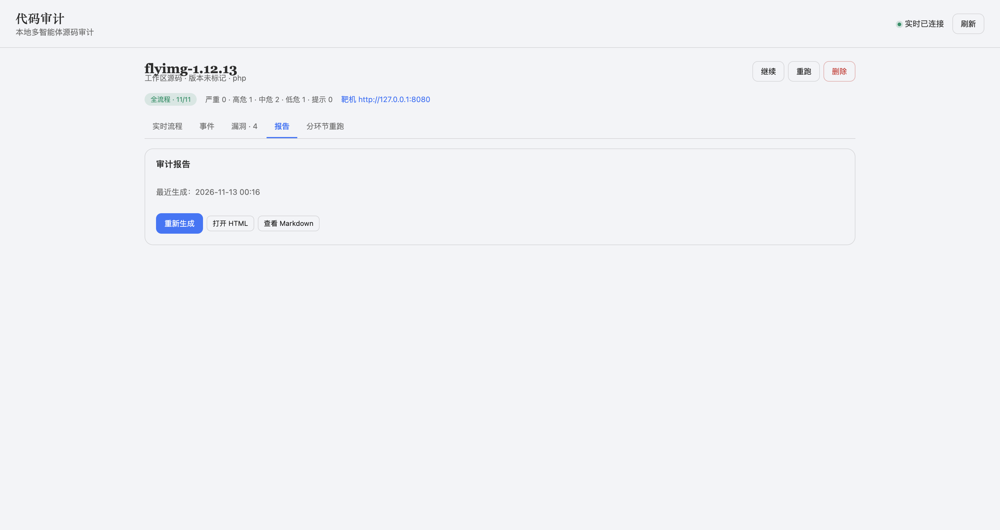

<p align="center">
  
</p>

<h1 align="center">代码审计</h1>

<p align="center">DeepSeek Harness 上的本地源码审计控制台。打开源码目录，对 AI 说「审计当前项目」。</p>

审计依次经过调度、多智能体审计、去重、代码级验证和红队二次评级。选择完整靶机时，再搭建环境，做远程验证和组合验证。

## 界面

实时流程同时显示代码审计和靶机验证。



漏洞按严重度列出，并标出验证状态。



审计结束后可以重新生成报告，并打开 HTML 或 Markdown。



## 安装

在 DSH 的 Plugins 页安装本目录，或执行：

```
plugin_manager install_bundle target=<本目录的绝对路径>
```

把要审计的源码作为工作区打开，在会话里说「审计当前项目」。会话顶部的「代码审计」页签用来看流程、漏洞和报告。

macOS 或 Linux 即可运行。完整靶机验证需要本机 Docker。

数据在 `${DSH_HOME}/codeaudit`。工作区审计不复制源码，产物写在工作区的 `.codeaudit/` 下。

## 许可

本项目以 [GNU Affero General Public License v3.0](https://www.gnu.org/licenses/agpl-3.0.html)（AGPL-3.0）开源。使用、修改或通过网络提供本程序时，须遵守该许可证。

添加微信请备注当前项目，如：SACDZ。

 
